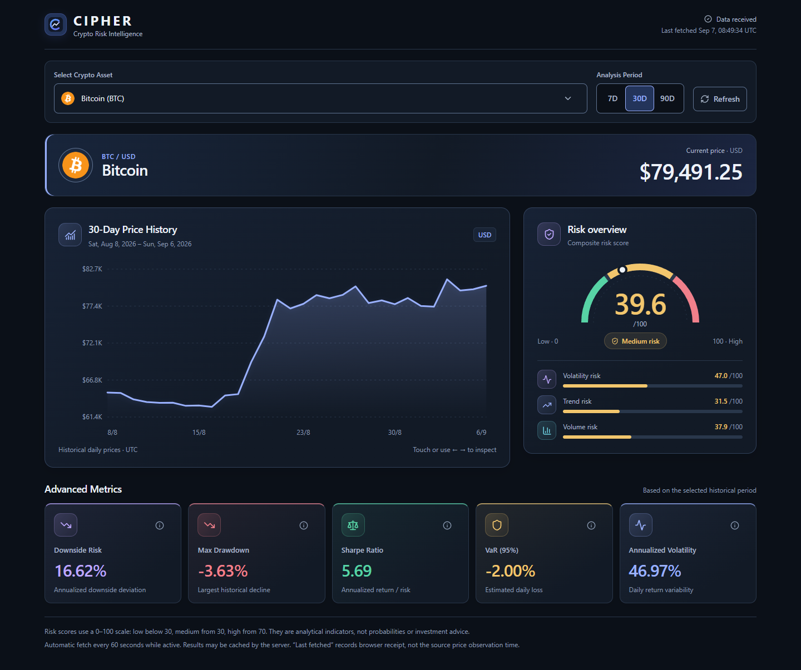
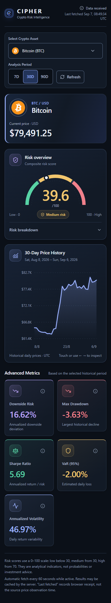
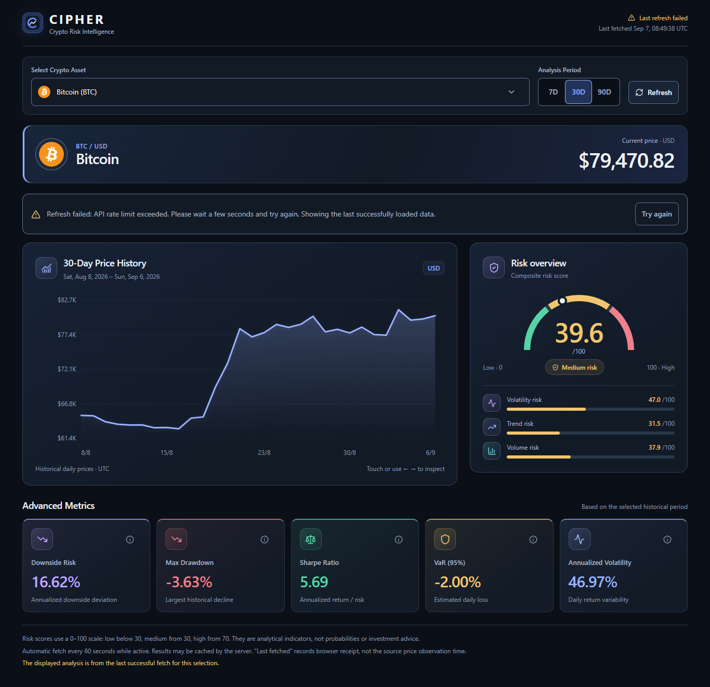
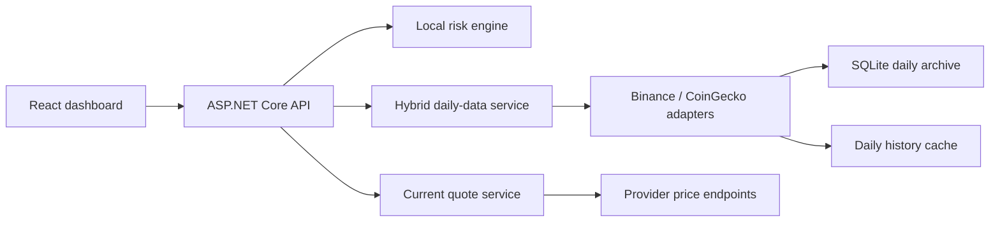

# CIPHER · Crypto Risk Analysis

**An explainable cryptocurrency market-risk dashboard built with .NET and React.**

[](https://github.com/maykk159/CryptoRiskAnalysis/actions/workflows/ci.yml)
[](https://dotnet.microsoft.com/)
[](https://react.dev/)
[](https://www.typescriptlang.org/)
[](docs/market-data.md#persistent-daily-history)

[Preview](#preview) · [Engineering](#engineering-decisions) · [Quick start](#quick-start) · [API](#api) · [Documentation](#documentation)

CIPHER turns completed daily observations from Binance and CoinGecko into historical risk metrics and a versioned 0–100 composite score. Users can explore 7-, 30-, and 90-day windows and inspect price history. The API exposes component contributions, input provenance, and warnings behind each analysis.

The project connects a deterministic C# risk engine, resilient market-data integration, SQLite history, and a responsive TypeScript dashboard. Its engineering focus is numerical correctness, explicit API contracts, and recoverable failure states.

## Preview



_Archived interface capture — September 7, 2026, before methodology 2.0.0. Displayed values and refresh behavior belong to that revision._

<details>
<summary>Mobile layout and refresh recovery</summary>



The responsive layout stacks the cards and provides an expandable risk breakdown.



This earlier QA scenario simulates an HTTP 429 response. The dashboard retains the previous analysis and offers an explicit retry action.

</details>

See the [visual QA gallery](.qa/cipher/README.md) for additional screenshots, scenario evidence, and capture limitations.

## Capabilities

- **Interactive analysis:** 20 dashboard assets, three analysis windows, and a responsive SVG price chart with keyboard and touch inspection.
- **Risk metrics:** Composite and component scores, annualized volatility, downside risk, maximum drawdown, annualized Sharpe, and historical daily VaR at 95%.
- **Current quote provenance:** A separately fetched price with provider, currency, and fetch time; completed daily history remains the input to risk calculations.
- **Persistent history:** Source-separated SQLite observations and a database-first historical API with recent gap backfill.
- **Refresh and recovery:** Periodic updates while active, manual refresh, loading and offline states, and retained results after failed refreshes.

The [asset catalog](client/src/constants/assets.ts) defines the dashboard choices. The API also accepts other CoinGecko asset IDs, subject to provider data availability.

## Engineering decisions

| Concern              | Implementation                                                                                                                                                                                         |
| -------------------- | ------------------------------------------------------------------------------------------------------------------------------------------------------------------------------------------------------ |
| Explainable scoring  | Methodology 2.0.0 returns fixed 40/30/30 weights, unrounded component contributions, observation dates/counts, risk level, and warnings. Rounding the sum of contributions reproduces the composite.   |
| Numerical edge cases | Undefined Sharpe is represented as `null` across C#, JSON, and TypeScript and displayed as “Unavailable.” Historical VaR converts log returns to percentage loss: a fall from 100 to 50 is a 50% loss. |
| Input integrity      | Duplicate, missing, or unordered UTC dates, nonpositive prices, and unavailable volume baselines are rejected. Invalid upstream data produces HTTP 502.                                                |
| Provider reliability | Binance-first routing with CoinGecko fallback for expected failures, concurrent cache-miss deduplication, cancellation, retries, timeouts, circuit breakers, and a shared CoinGecko request budget.    |
| Maintainability      | Backend responsibilities are separated within one Web API project. Frontend hooks own query and interaction behavior; components render the cards and SVG chart.                                       |

The [methodology specification](docs/risk-methodology.md) records formulas, thresholds, rounding, assumptions, and compatibility. The [portfolio case study](docs/portfolio.md) distinguishes the September 10 methodology revision from subsequent development.

> [!NOTE]
> The composite score is a project-specific historical indicator. Weights and thresholds are design choices, not empirically calibrated predictions. This is an analytical and educational project, not investment advice.

## Architecture



Daily observations and current quotes have independent caches. Risk calculations use completed UTC daily history; the displayed price comes from the same provider's price endpoint. Data collection is on demand.

See [architecture and application behavior](docs/architecture.md) for component responsibilities, request flow, historical reads, and deployment configuration.

## Technology stack

| Layer                       | Technologies                                                         |
| --------------------------- | -------------------------------------------------------------------- |
| Backend                     | C#, .NET 10, ASP.NET Core Web API                                    |
| Data and integration        | SQLite, Binance Spot API, CoinGecko API                              |
| Reliability and diagnostics | Microsoft.Extensions.Http.Resilience / Polly, rate limiting, Serilog |
| Frontend                    | React 19, TypeScript 5.9, Vite 7, Tailwind CSS, Lucide React         |
| State and visualization     | TanStack Query, browser `fetch`, custom SVG charts                   |
| Verification                | xUnit, Moq, Vitest, Testing Library, GitHub Actions                  |

## Quick start

**Prerequisites:** stable .NET 10 SDK, a supported Node.js version, npm 10+, and Git. See [exact version requirements](REQUIREMENTS.md#prerequisites).

### 1. Clone and prepare dependencies

```bash
git clone https://github.com/maykk159/CryptoRiskAnalysis.git
cd CryptoRiskAnalysis
```

On Windows:

```powershell
.\setup.cmd
```

Setup checks prerequisites, restores backend packages, and installs locked frontend dependencies. Healthy unchanged frontend installs are reused. No provider API keys or separate database server are required.

For macOS/Linux, use the [manual setup instructions](REQUIREMENTS.md#manual-setup). Setup options and troubleshooting are documented in [REQUIREMENTS.md](REQUIREMENTS.md).

### 2. Start the applications

Run each block in a separate terminal opened at the repository root.

**API**

```bash
cd CryptoRiskAnalysis.API
dotnet run
```

**Client**

```bash
cd client
npm run dev
```

| Application         | Local URL                                               |
| ------------------- | ------------------------------------------------------- |
| Dashboard           | [localhost:5173](http://localhost:5173)                 |
| Development Swagger | [localhost:5058/swagger](http://localhost:5058/swagger) |

On Windows PowerShell, use `npm.cmd run dev` if execution policy blocks `npm.ps1`. Stop either application with `Ctrl+C`.

## Configuration

The client defaults to `http://localhost:5058/api`. To use another backend, create `client/.env.local`:

```dotenv
VITE_API_URL=https://api.example.com/api
```

Local environment files are ignored by Git. Backend settings cover CORS, trusted reverse proxies, HTTPS redirection, SQLite storage, and the CoinGecko request budget; see [deployment configuration](docs/architecture.md#reliability-and-configuration).

## API

| Endpoint                                                       | Purpose                                                                                          |
| -------------------------------------------------------------- | ------------------------------------------------------------------------------------------------ |
| `GET /api/RiskAnalysis/{assetId}?days=30`                      | Risk metrics, current quote, daily history, and methodology metadata; supports 7, 30, or 90 days |
| `GET /api/marketdata/{assetId}/history?days=30&source=Binance` | Persisted daily observations with recent gap backfill; supports 1–90 days                        |

```bash
curl "http://localhost:5058/api/RiskAnalysis/bitcoin?days=30"
```

Risk responses use a standard `{ succeeded, message, data, errors }` envelope. Add `refresh=true` to bypass the current-quote cache; historical caching and provider quotas still apply.

See [API contracts and HTTP errors](docs/architecture.md#api-reference) and [historical API parameters](docs/market-data.md#historical-api).

## Testing and CI

[GitHub Actions](.github/workflows/ci.yml) runs three independent jobs on every push and pull request:

| Job               | Checks                                                                           |
| ----------------- | -------------------------------------------------------------------------------- |
| Backend · Ubuntu  | Restore, formatting, Release build with warnings as errors, xUnit tests          |
| Frontend · Ubuntu | Locked dependency installation, formatting, lint, Vitest tests, production build |
| Setup · Windows   | Isolated regression checks using fake CLI tools                                  |

Tests cover numerical examples and invariants, provider validation and fallback, cancellation and concurrent requests, SQLite persistence, API serialization, and dashboard interaction and recovery. See [coverage and limitations](docs/architecture.md#verification).

On Windows, prepare dependencies and run application checks with:

```powershell
.\setup.cmd -Verify
```

Backend formatting and setup regression tests have separate commands in [local verification instructions](REQUIREMENTS.md#verify).

## Documentation

| Document                                     | Contents                                                                              |
| -------------------------------------------- | ------------------------------------------------------------------------------------- |
| [Requirements and setup](REQUIREMENTS.md)    | Supported tools, installation, run commands, verification, and troubleshooting        |
| [Architecture](docs/architecture.md)         | Component responsibilities, request flow, API contracts, and deployment configuration |
| [Risk methodology](docs/risk-methodology.md) | Formulas, weights, nullable metrics, warnings, and compatibility                      |
| [Market data](docs/market-data.md)           | Providers, quotes, SQLite history, cache, quotas, and historical backfill             |
| [Portfolio kit](docs/portfolio.md)           | Technical case study, demo script, CV bullets, and interview talking points           |

Earlier semester and bug-review reports are retained in [the documentation archive](docs/archive/). Dated screenshots and QA results are in [the visual gallery](.qa/cipher/README.md).

## Author

**Enes Camkaya** · [GitHub @maykk159](https://github.com/maykk159)
