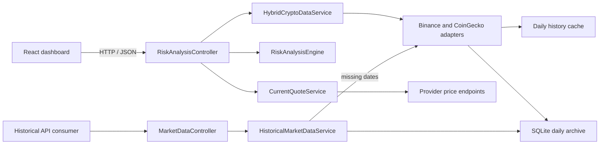

# Architecture and application behavior

This document describes the current implementation. See [setup and troubleshooting](../REQUIREMENTS.md), [risk methodology](risk-methodology.md), and [market-data behavior](market-data.md) for their detailed contracts.

## System organization

CIPHER consists of a .NET 10 ASP.NET Core API and a React 19 / TypeScript client built with Vite. The backend uses a pragmatic layered organization within one Web API assembly. Controllers, services, models/DTOs, middleware, and provider adapters have separate responsibilities; interfaces and dependency injection make services independently testable. There are no separate Domain, Application, or Infrastructure projects, so this is not described as strict Clean Architecture.



### Backend responsibilities

| Responsibility | Implementation |
|---|---|
| Risk HTTP endpoint | [RiskAnalysisController](../CryptoRiskAnalysis.API/Controllers/RiskAnalysisController.cs) validates requests, coordinates historical inputs and current quotes, and returns the response envelope. |
| Provider routing | [HybridCryptoDataService](../CryptoRiskAnalysis.API/Services/HybridCryptoDataService.cs) selects Binance for mapped assets and CoinGecko for unsupported mappings or expected Binance failures. |
| Provider adapters | [BinanceSpotService](../CryptoRiskAnalysis.API/Services/BinanceSpotService.cs) and [CoinGeckoService](../CryptoRiskAnalysis.API/Services/CoinGeckoService.cs) separate HTTP access, parsing, validation, persistence, and cache publication. |
| Input validation | [MarketDataValidator](../CryptoRiskAnalysis.API/Services/MarketDataValidator.cs) validates completed daily prices and aligned volumes before they are used or persisted. |
| Risk calculations | [RiskAnalysisEngine](../CryptoRiskAnalysis.API/Services/RiskAnalysisEngine.cs) coordinates local calculations for returns, volatility, trend, volume, drawdown, VaR, Sharpe, and warnings. |
| Shared methodology | [RiskMethodology](../CryptoRiskAnalysis.API/Models/RiskMethodology.cs) defines the version, fixed weights, and composite classification thresholds shared with response metadata. |
| Current price | [CurrentQuoteService](../CryptoRiskAnalysis.API/Services/CurrentQuoteService.cs) retrieves a separately cached quote from the same provider as the historical series. |
| Historical reads | [HistoricalMarketDataService](../CryptoRiskAnalysis.API/Services/HistoricalMarketDataService.cs) reads SQLite first and backfills missing recent observations through provider adapters. |
| Error handling | [ExceptionHandlingMiddleware](../CryptoRiskAnalysis.API/Middleware/ExceptionHandlingMiddleware.cs) maps failures to HTTP status codes and JSON envelopes. |
| Service registration | [ServiceCollectionExtensions](../CryptoRiskAnalysis.API/Extensions/ServiceCollectionExtensions.cs) coordinates partial files for [market data and resilience](../CryptoRiskAnalysis.API/Extensions/ServiceCollectionExtensions.MarketData.cs), [rate limiting](../CryptoRiskAnalysis.API/Extensions/ServiceCollectionExtensions.RateLimiting.cs), and [HTTP/hosting configuration](../CryptoRiskAnalysis.API/Extensions/ServiceCollectionExtensions.Http.cs). Public registration methods remain the entry points. |

### Frontend responsibilities

The frontend separates rendering from stateful behavior:

- [Dashboard](../client/src/components/Dashboard.tsx) composes controls, cards, chart, and recovery states. [useRiskAnalysis](../client/src/hooks/useRiskAnalysis.ts) owns polling and manual refresh; [useAnalysisUrlState](../client/src/hooks/useAnalysisUrlState.ts) owns browser navigation.
- [AssetSelector](../client/src/components/AssetSelector.tsx) provides the asset selector. The current catalog is in [assets.ts](../client/src/constants/assets.ts).
- [usePriceChart](../client/src/hooks/usePriceChart.ts) owns sizing and pointer/keyboard inspection. The pure [chart model](../client/src/utils/priceChartModel.ts) calculates coordinates; [PriceChart](../client/src/components/PriceChart.tsx) renders the SVG and tooltip. Recharts is not used.
- [usePriceFlash](../client/src/hooks/usePriceFlash.ts) owns price-change direction and timer cleanup. [AssetSummary](../client/src/components/dashboard/AssetSummary.tsx) presents the current quote.
- [RiskDial](../client/src/components/dashboard/RiskDial.tsx) renders the gauge. [RiskScoreCard](../client/src/components/dashboard/RiskScoreCard.tsx) coordinates animation and the responsive component breakdown.
- [AdvancedMetrics](../client/src/components/dashboard/AdvancedMetrics.tsx) presents downside risk, drawdown, Sharpe, VaR, and annualized volatility. Undefined Sharpe is displayed as unavailable.
- [api.ts](../client/src/services/api.ts) uses browser `fetch` and cancellation signals. TanStack Query manages server state.

## Risk request lifecycle

1. The user selects an asset and a 7-, 30-, or 90-day window. The client requests `/api/RiskAnalysis/{assetId}?days={days}`.
2. The controller validates the asset identifier and period. The hybrid service uses Binance when a symbol mapping exists; otherwise it uses CoinGecko.
3. Expected Binance provider, rate-limit, timeout, or open-circuit failures allow fallback. Caller cancellation and unexpected programming errors propagate instead of silently triggering fallback.
4. The provider returns exactly the requested number of completed daily price and volume observations. Prices must be positive; volumes must be nonnegative and aligned by UTC date. Missing or inconsistent inputs cannot become a successful analysis.
5. Validated observations are persisted before a new result is published to the daily cache. Concurrent cache misses for the same key share one provider fetch. Persistence failure prevents publication of that new cached result.
6. The risk engine calculates all metrics locally from the validated inputs. Methodology 2.0.0 uses fixed volatility/trend/volume weights of 40/30/30 and reports contributions and limitations.
7. The controller obtains a current quote from the historical series' provider, maps the result to the DTO, and returns an `ApiResponse<T>` envelope with `Cache-Control: no-store`.
8. React renders the result. A failed refresh keeps the last successful same-query result visible with an error and retry action.

Daily history and the current quote serve different purposes. Risk calculations use completed daily observations; the displayed price comes from a provider price endpoint. Binance quotes and volume use USDT; CoinGecko uses USD and a different market scope. Binance volume is quote-asset turnover rather than base-coin quantity. These source differences constrain comparisons and are not normalized away.

### Cache and refresh behavior

| Capability | Binance | CoinGecko |
|---|---|---|
| Role | Primary for mapped assets | Fallback and long-tail assets |
| Daily market data | Completed USDT klines | Completed USD daily market chart |
| Daily history cache | 60 seconds | 60 seconds |
| Current quote cache | 10 seconds | 30 seconds |
| Local-development API key | Not required | Not required |

Daily cache keys include the provider, asset/symbol, and lookback window. Quote keys are independent of the selected period. **Refresh** adds `refresh=true` to bypass the quote cache while preserving historical caching and provider quota protection. The dashboard polls every 10 seconds while active and revalidates on period changes. No scheduled background collector runs while the application is idle.

See [market-data documentation](market-data.md) for quote timestamps, cache-hit persistence, alias handling, SQLite schema, source isolation, historical gap backfill, and outgoing request-budget rules.

## API reference

### Risk analysis

```http
GET /api/RiskAnalysis/{assetId}?days={7|30|90}&refresh={true|false}
```

- `assetId` uses a CoinGecko identifier such as `bitcoin`, `ethereum`, or `polygon-ecosystem-token`.
- `days` defaults to 30. Only 7, 30, and 90 are accepted; each successful response contains exactly that many completed daily observations.
- `refresh` defaults to false and bypasses only the current-quote cache.
- `currentPrice` and `currentQuote` come from the historical series' provider. `priceHistory` contains completed UTC daily observations.
- `methodology` contains the version, input dates/counts, fixed weights, unrounded contributions, risk level, and warnings. `sharpeRatio` permits null.

```bash
curl "http://localhost:5058/api/RiskAnalysis/bitcoin?days=30"
```

The following abbreviated JSON illustrates the envelope and metric fields. It omits `currentQuote`, `methodology`, and the remaining history points; its values are illustrative, not a live response.

```json
{
  "succeeded": true,
  "message": null,
  "data": {
    "assetId": "bitcoin",
    "compositeRiskScore": 31.42,
    "currentPrice": 111234.56,
    "volatilityScore": 38.17,
    "trendScore": 24.86,
    "volumeScore": 29.35,
    "downsideRisk": 42.68,
    "maxDrawdown": 12.71,
    "sharpeRatio": 0.84,
    "valueAtRisk95": 4.12,
    "annualizedVolatility": 61.73,
    "priceHistory": [{ "timestamp": 1756684800000, "price": 108245.37 }]
  },
  "errors": null
}
```

The [response DTO](../CryptoRiskAnalysis.API/DTOs/RiskAnalysisResponseDto.cs) and development Swagger UI describe the full response. Live results depend on the asset, window, provider, and request time.

### Historical observations

```http
GET /api/marketdata/bitcoin/history?days=30&source=Binance
```

This endpoint reads persisted observations and backfills missing recent dates. Its period range is 1–90, unlike the risk endpoint's three fixed selections. See [historical API parameters and responses](market-data.md#historical-api).

### HTTP responses

| Status | Meaning |
|---|---|
| `200` | Request completed successfully |
| `400` | Invalid asset identifier, period, or historical date range |
| `404` | Asset or market data not found |
| `422` | Historical dates are missing outside the supported backfill range |
| `429` | Incoming application limit or outgoing provider limit reached |
| `502` | Provider response is unsuccessful, malformed, incomplete, or unsuitable for analysis |
| `503` | Provider circuit is open |
| `504` | Provider request timed out |
| `500` | Unexpected application error |

Application-generated failures use the same envelope with `succeeded: false`. Production responses hide internal exception details.

## Reliability and configuration

The provider HTTP pipelines use exponential backoff with jitter and up to three retries for transient network failures, 408, 429, and 5xx responses. Each attempt has a 10-second timeout and each pipeline has a 30-second total timeout. Circuit breaking uses a 50% failure ratio, at least five outcomes within 30 seconds, and a 30-second break duration. These are configuration rules, not measured latency or availability guarantees.

CoinGecko has a shared, configurable outgoing budget, defaulting to 20 attempts per rolling minute per application instance, and honors `Retry-After`. This application budget is distinct from any provider plan allowance. Provider limits can depend on plan, IP, and endpoint weight. See [budget and cooldown behavior](market-data.md#coingecko-request-budget).

The incoming API policy allows 30 requests per fixed one-minute window per resolved client IP, with no request queue. Rejections use a JSON envelope. Behind a reverse proxy, list trusted addresses or CIDR ranges so rate limiting uses the originating client IP; forwarded headers from untrusted remote sources are ignored.

```json
"ReverseProxy": {
  "ForwardLimit": 1,
  "KnownProxies": ["10.0.0.100"],
  "KnownNetworks": ["10.1.0.0/16"]
}
```

Configuration values can also be provided through environment variables:

| Setting | Purpose |
|---|---|
| `Cors__AllowedOrigins__0` | Deployed frontend origin, such as `https://risk.example.com`; use subsequent indexes for additional origins |
| `HttpsRedirection__HttpsPort` | HTTPS redirect destination port; defaults to 443 with HTTP 308 |
| `ReverseProxy__KnownProxies__0` | Trusted proxy IP; use `ReverseProxy__KnownNetworks__0` for CIDR ranges |
| `HistoricalData__DatabasePath` | SQLite archive location; use persistent storage in deployment |
| `CoinGecko__RequestsPerMinute` | Outgoing request budget per application instance |

An allowed origin includes its scheme, host, and optional port, without a path. Local configuration permits Vite origins on ports 5173 and 5174. Development uses HTTP and exposes Swagger; non-development environments enable HSTS and HTTPS redirection. No authentication is implemented. Public market-data integration does not require API keys.

Before public deployment, configure TLS at Kestrel or a trusted reverse proxy, trusted forwarded headers, deployed CORS origins, `ASPNETCORE_ENVIRONMENT=Production`, and persistent SQLite storage. Review traffic limits, provider terms and availability, and monitoring. Add authentication if the deployment should be restricted. Multiple application instances sharing an upstream quota require coordinated outgoing budgets.

### Backend dependencies

- `Microsoft.Extensions.Http.Resilience` supplies retry, timeout, and circuit-breaker handlers.
- `Microsoft.Data.Sqlite` supplies persistent daily history.
- `Serilog.AspNetCore` supplies console and rolling-file logging.
- `Swashbuckle.AspNetCore` supplies development OpenAPI/Swagger UI.

## Verification

The [CI workflow](../.github/workflows/ci.yml) runs on every push and pull request with three independent jobs:

| Job | Environment | Checks |
|---|---|---|
| Setup | Windows | Setup regression checks with isolated fake tools; no real dependency installation |
| Backend | Ubuntu / .NET 10 | Restore, formatting check, Release build with warnings as errors, tests |
| Frontend | Ubuntu / Node 24 | Lockfile installation, formatting check, lint, Vitest, production build |

Backend tests cover controller behavior, mathematical examples and boundaries, cancellation, provider validation and fallback, concurrent cache misses, response disposal, persistence failures before cache publication, service lifetimes, resilience policies, middleware, rate-limit responses, current quotes, and temporary real SQLite databases.

Frontend tests cover formatting, asset and period selection, loading and retained-result recovery, nullable metrics and warnings, manual refresh, chart pointer/keyboard behavior and resizing, and price-change feedback. Component tests do not replace a browser-to-API end-to-end suite. The archived [visual QA report](../.qa/cipher/README.md) describes its own date and validation limits.

See [local verification commands](../REQUIREMENTS.md#verify). Implementation tests establish bounded correctness; no prediction accuracy, throughput, memory, or production-availability claim is made without reproducible evidence.

## Repository structure

```text
CryptoRiskAnalysis/
├── CryptoRiskAnalysis.API/       ASP.NET Core API
│   ├── Controllers/              Risk and history endpoints
│   ├── DTOs/                     API response models
│   ├── Exceptions/               Typed market-data failures
│   ├── Extensions/               DI, resilience, CORS, and rate limits
│   ├── Interfaces/               Service contracts
│   ├── Middleware/               Global exception handling
│   ├── Models/                   Price, quote, and risk models
│   ├── Services/                 Providers, persistence, and risk engine
│   └── Wrappers/                 Shared response envelope
├── CryptoRiskAnalysis.Tests/     Backend tests
├── client/src/                   React / TypeScript application
│   ├── components/               Dashboard, cards, and chart rendering
│   ├── constants/                Supported asset catalog
│   ├── hooks/                    Stateful UI and query behavior
│   ├── services/                 API client
│   ├── types/                    TypeScript contracts
│   └── utils/                    Formatting and pure chart model
├── docs/                         Architecture, methodology, data, portfolio
│   └── archive/                  Historical reports
├── .qa/cipher/                   Archived screenshots and QA evidence
├── .github/workflows/ci.yml      Three quality-check jobs
├── scripts/                     Setup regression checks and fixtures
├── CryptoRiskAnalysis.API.sln
├── README.md                     Project introduction and quick start
├── REQUIREMENTS.md               Detailed setup and troubleshooting
├── setup.cmd                     Windows entry point
└── setup.ps1                     Setup implementation
```

Earlier reports are retained for context: [semester report](archive/projectfirstreport.md) and [bug-review record](archive/bug-report-review.md). They are not the current implementation reference.
